<div align="center">

# LexVault

### Secure Role-Based Legal Case Database with Blockchain-Enabled Data Integrity

A legal case research and management platform for law students, faculty and administrators.
Judgment PDFs are fingerprinted with SHA-256 and registered on an Ethereum-compatible smart contract,
so any later change to a document can be detected.


<br />

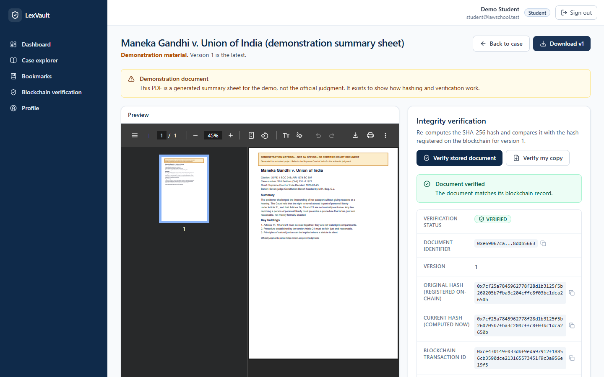

<sub>A real capture of the running application: the registered on-chain hash and the freshly computed hash match.</sub>

</div>

---

## Contents

[Overview](#overview) · [Problem](#problem-statement) · [Objectives](#project-objectives) · [Features](#key-features) · [Roles](#user-roles-and-permissions) · [Stack](#technology-stack) · [Architecture](#system-architecture) · [Workflow](#application-workflow) · [Blockchain](#blockchain-data-integrity) · [Database](#database-architecture) · [Structure](#project-folder-structure) · [Setup](#getting-started) · [API](#api-documentation) · [Testing](#testing) · [Screenshots](#application-screenshots) · [Security](#security-considerations) · [Future work](#future-enhancements)

## Overview

LexVault gives a law school one place to browse, search and verify landmark judgments.

- **Students** research published cases, preview and download documents, and verify a document against the blockchain.
- **Faculty** add case records, upload judgment PDFs and submit cases for approval.
- **Administrators** approve content, manage users and roles, and monitor audit logs, blockchain registrations and analytics.

All permissions are enforced on the server. The sample cases are public Indian Supreme Court decisions. The PDFs in the demo are **generated summary sheets labelled as demonstration material**, not official or court-certified judgments.

## Problem statement

Case material circulates as loose PDFs. It is hard to tell whether a copy is complete or unaltered, and shared storage gives little control over who may add or change records.

## Project objectives

1. Secure authentication and role-based access control.
2. A searchable legal case database with an approval workflow.
3. Private document storage with immutable versioning.
4. Tamper-evident integrity checking using SHA-256 hashes anchored on a blockchain.
5. An audit trail of important actions, plus dashboards and analytics.

## Key features

| Area | What is implemented |
|---|---|
| Authentication | Registration, login, logout; bcrypt password hashes; JWT in an httpOnly cookie; rate limiting on credential endpoints |
| Access control | Student / Faculty / Admin roles enforced by server middleware; ownership and visibility rules; deactivated accounts blocked immediately |
| Cases | Create, edit, search (title, case number, court, year, category, free text), filter, sort, paginate, bookmark; draft, pending, published, rejected and archived states |
| Documents | PDF-only upload (MIME, extension, `%PDF-` header and `%%EOF` trailer checks), size limit, safe file names, private storage, authorized preview and download, immutable versions |
| Blockchain | SHA-256 of the original bytes registered on a smart contract; transaction hash and block number stored; submitted and confirmed states kept separate; safe retry |
| Verification | `VERIFIED`, `TAMPERED`, `NOT_REGISTERED`, `VERIFICATION_ERROR`, for the stored file or a copy the user uploads; verification history |
| Audit | Logins, case and document events, blockchain operations, verifications and denied requests recorded; read-only through the API |
| Insight | Role-specific dashboards; admin analytics; read-only system settings |

## User roles and permissions

| Capability | Student | Faculty | Admin |
|---|:-:|:-:|:-:|
| Browse and search published cases; view, preview, download, verify; bookmark | ✔ | ✔ | ✔ |
| Create and edit own cases; upload documents; submit for approval | | ✔ | ✔ |
| View relevant audit logs and verification history of own documents | | ✔ | ✔ |
| Approve or reject submissions; archive or delete cases | | | ✔ |
| Manage users and roles | | | ✔ |
| All audit logs, blockchain records, analytics, system settings | | | ✔ |

Students only ever see published cases. Faculty can edit their own cases only while the case is a draft or rejected.

## Technology stack

| Layer | Technology |
|---|---|
| Frontend | React 18, TypeScript, Vite, Tailwind CSS 3, React Router 6, Axios, React Hook Form, Zod, Lucide, Recharts |
| Backend | Node.js 22, Express 4, TypeScript, MongoDB with Mongoose 8, JSON Web Tokens, bcrypt, Multer, Zod, Helmet, express-rate-limit |
| Blockchain | Solidity 0.8.24, Hardhat 2, ethers.js v6, local Hardhat network (optional Sepolia configuration) |
| Testing | Hardhat (Mocha/Chai), Jest, Supertest, mongodb-memory-server, Vitest, Testing Library, Playwright (screenshots) |

## System architecture

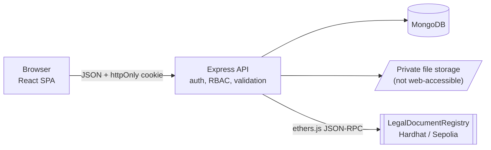

The browser never talks to the blockchain and never holds a signing key; the backend signs registration transactions. See [docs/ARCHITECTURE.md](docs/ARCHITECTURE.md).

## Application workflow

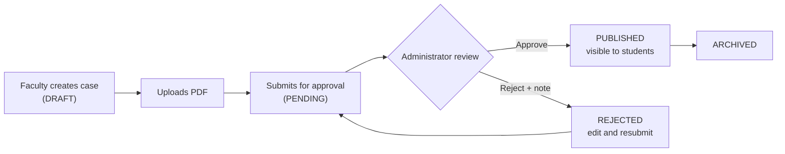

## Blockchain data integrity

Only a fingerprint goes on the blockchain, never the file.

- **What is stored on-chain:** a document identifier hash, the SHA-256 content hash, the version number, an opaque uploader reference (a hash, not a name or e-mail), the registrar account and the block timestamp.
- **Smart contract:** `LegalDocumentRegistry` is append-only per document. Registering an existing document, repeating the latest hash, using an empty hash or calling without registrar permission is rejected. There is no update or delete function. See [docs/BLOCKCHAIN_DESIGN.md](docs/BLOCKCHAIN_DESIGN.md).
- **Submitted is not confirmed:** a registration is `SUBMITTED` once the transaction is sent and `CONFIRMED` only after the receipt and block number are read.
- **What a match proves:** that the file is byte-for-byte identical to the one registered. It does **not** prove the original was an authentic court-issued document.

## SHA-256 verification workflow

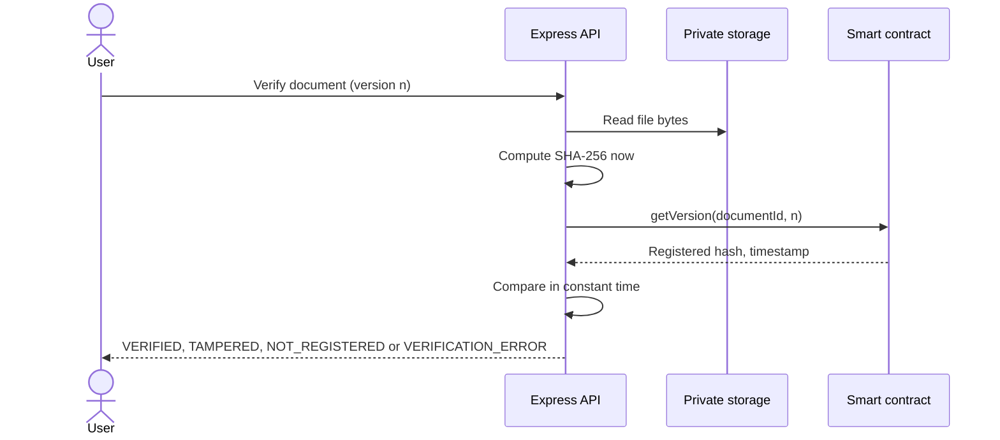

The hash saved in MongoDB is shown for reference only. Verification trusts the chain, so editing both a file and its database hash is still detected.

<table>
<tr>
<td width="50%"><br /><sub><b>VERIFIED</b>: registered and current hashes match.</sub></td>
<td width="50%">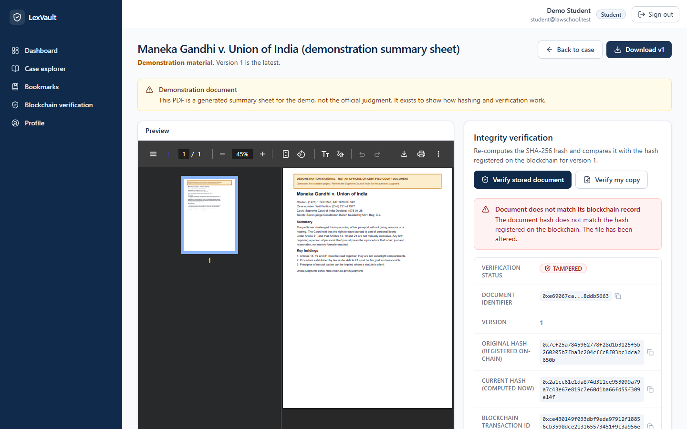<br /><sub><b>TAMPERED</b>: a stored demo file was altered on disk; the hashes differ. The original bytes were restored afterwards.</sub></td>
</tr>
</table>

## Database architecture

Seven MongoDB collections: `users`, `legalcases`, `documents`, `documentversions`, `blockchainrecords`, `bookmarks`, `auditlogs`. Details and indexes: [docs/DATABASE_SCHEMA.md](docs/DATABASE_SCHEMA.md).

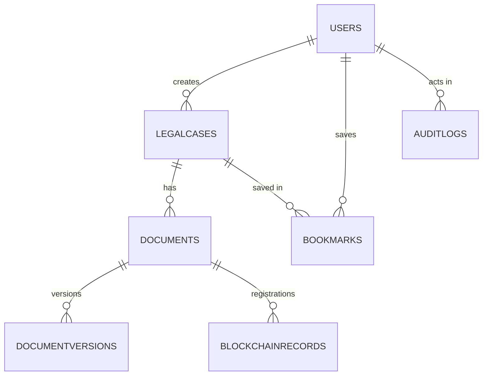

## Project folder structure

```
secure-legal-case-management/
├── blockchain/        Solidity contract, Hardhat config, deploy script, contract tests
├── backend/
│   ├── src/           config, controllers, middleware, models, routes, services, utils, validators
│   ├── scripts/       seed data, demo PDF generator, dev database, smoke test
│   └── tests/         Jest + Supertest integration tests
├── frontend/
│   ├── src/           components, pages, layouts, hooks, services, context, routes, types, utils
│   └── e2e/           Playwright screenshot capture script
├── docs/              architecture, database, API, blockchain, security, screenshots
├── .env.example       environment template (copy to .env)
└── PROJECT_PROGRESS.md
```

## Getting started

### Installation prerequisites

- **Node.js 20 or newer** (developed on 22) and npm 10+
- **Git**
- **MongoDB**: either your own instance, or the bundled helper (`npm run dev:db`) which downloads a MongoDB binary (about 780 MB) on first use
- Google Chrome, only if you want to regenerate the screenshots

### Installation

```powershell
git clone https://github.com/Astik01/secure-legal-case-management.git
cd secure-legal-case-management
npm install
```

### Environment configuration

```powershell
Copy-Item .env.example .env
# Generate a random JWT secret and write it into .env
$secret = node -e "console.log(require('crypto').randomBytes(48).toString('hex'))"
(Get-Content .env) -replace '^JWT_SECRET=.*', "JWT_SECRET=$secret" | Set-Content .env
```

`.env` is git-ignored. Key variables:

| Variable | Purpose |
|---|---|
| `MONGODB_URI` | Database connection (default `mongodb://127.0.0.1:27017/legal_case_db`) |
| `JWT_SECRET` | Signing secret for sessions; must be a strong random value in production |
| `BLOCKCHAIN_RPC_URL`, `BLOCKCHAIN_DEPLOYMENT_FILE` | Where the chain is and which deployed contract to use |
| `BLOCKCHAIN_PRIVATE_KEY` | Backend signer. The template uses Hardhat's **public** test key (fake ETH). Never use it on a real network |
| `STORAGE_DIR`, `MAX_UPLOAD_MB` | Private document storage and size limit |
| `SEED_*` | Demo account e-mails and passwords |

### Run the project

Open **separate PowerShell windows** in the repository root, in this order. Steps 1 and 2 keep running.

| # | Component | Command | Result |
|---|---|---|---|
| 1 | **MongoDB** | `npm run dev:db` | Local database on `127.0.0.1:27017` (data kept in `backend/.devdb`). Skip if you set `MONGODB_URI` to your own MongoDB |
| 2 | **Hardhat blockchain** | `npm run chain` | Local chain on `http://127.0.0.1:8545` (chain id 31337) |
| 3 | **Deploy the smart contract** | `npm run chain:deploy` | Writes `blockchain/deployments/localhost.json` |
| 4 | **Seed demo data** | `npm run seed` | Users, cases, demo PDFs, on-chain registration |
| 5 | **Backend** | `npm run dev:backend` | API on `http://localhost:4000` |
| 6 | **Frontend** | `npm run dev:frontend` | App on `http://localhost:5173` |

Quick check once everything is up:

```powershell
Invoke-RestMethod http://localhost:4000/api/health
```

> The local chain keeps its state in memory. If you restart `npm run chain`, run `npm run chain:deploy` and then `npm run seed` again; the seed re-registers any document the new chain does not know about.

**Production-style build:** `npm run build`, then `npm start -w backend`, and serve `frontend/dist` behind a reverse proxy that forwards `/api` to the backend.

### Demo credentials

For local development only. They are created by `npm run seed`, are public in this repository, and must never be used in production (the seed refuses to run when `NODE_ENV=production`). Override them with `SEED_*` in `.env`.

| Role | Email | Password |
|---|---|---|
| Administrator | `admin@lawschool.test` | `Admin@12345` |
| Faculty | `faculty@lawschool.test` | `Faculty@12345` |
| Student | `student@lawschool.test` | `Student@12345` |

Seeded cases: *Kesavananda Bharati*, *Maneka Gandhi*, *Vishaka*, *Puttaswamy*, *Shreya Singhal* and *M.C. Mehta (Oleum Gas Leak)* (published), and *Navtej Singh Johar* (pending, to demonstrate approval). Only bibliographic facts and short original summaries are included. Check citations against the official Supreme Court of India portal before relying on them.

## API documentation

The REST API is documented in [docs/API_DOCUMENTATION.md](docs/API_DOCUMENTATION.md): authentication, users, cases, bookmarks, documents, blockchain, audit logs, dashboards. Related documents: [Architecture](docs/ARCHITECTURE.md) · [Database schema](docs/DATABASE_SCHEMA.md) · [Blockchain design](docs/BLOCKCHAIN_DESIGN.md) · [Security](docs/SECURITY.md).

## Testing

```powershell
npm test                      # everything below
npm run test -w blockchain    # smart contract tests
npm run test -w backend       # API and integration tests
npm run test -w frontend      # UI and component tests
npm run smoke                 # live end-to-end check of the running application
```

| Suite | Tests | Covers |
|---|---:|---|
| Smart contract (Hardhat) | 7 | registration, duplicate prevention, versions, verification, access control |
| Backend (Jest, Supertest) | 68 | auth, RBAC, cases, documents, blockchain, tamper detection, audit, analytics. Uses an in-memory MongoDB and a real Hardhat node on port 8546 |
| Frontend (Vitest) | 27 | design system, auth forms, route guards, case form, verification display, role management |
| Live smoke test | 85 checks | the running stack: registration, login, RBAC, search, uploads, versions, validation, on-chain registration, verification, tamper detection, audit entries |

Last full run: **102 automated tests passing** and **85 of 85 smoke-test checks passing**. The backend and frontend also type-check and build without errors.

To regenerate the screenshots against a running stack: `npm run screenshots`.

## Application screenshots

All images are captured from the running application with Playwright, using the demo accounts and seeded data.

### Landing page
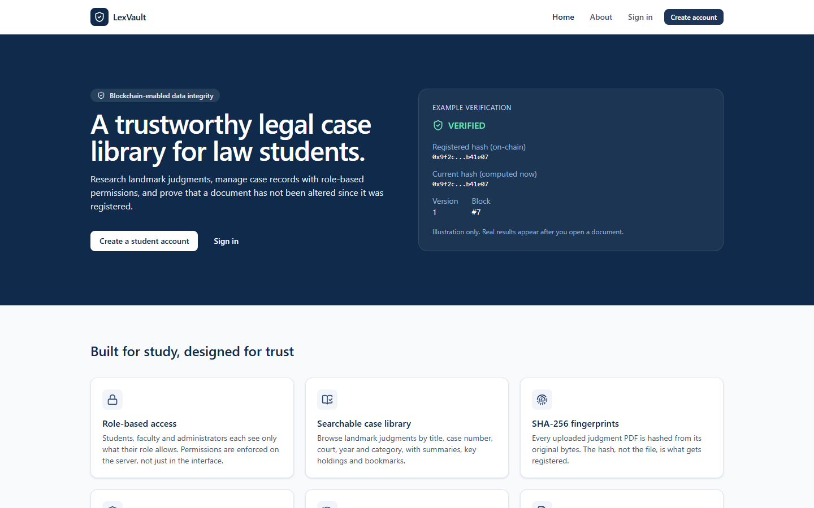

### Sign in and registration
| Sign in | Registration |
|---|---|
| 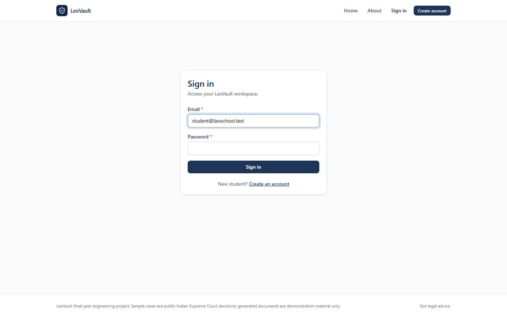 | 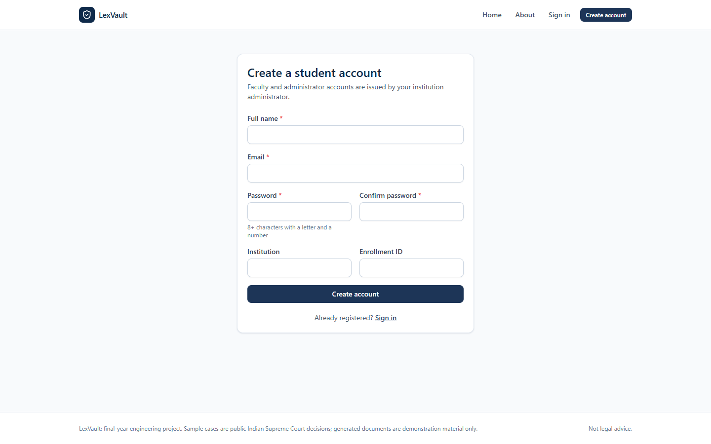 |

### Student dashboard
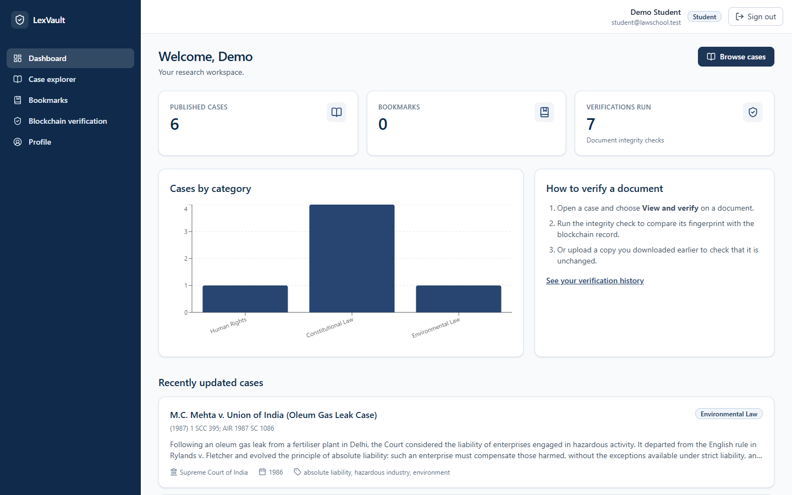

### Legal case explorer
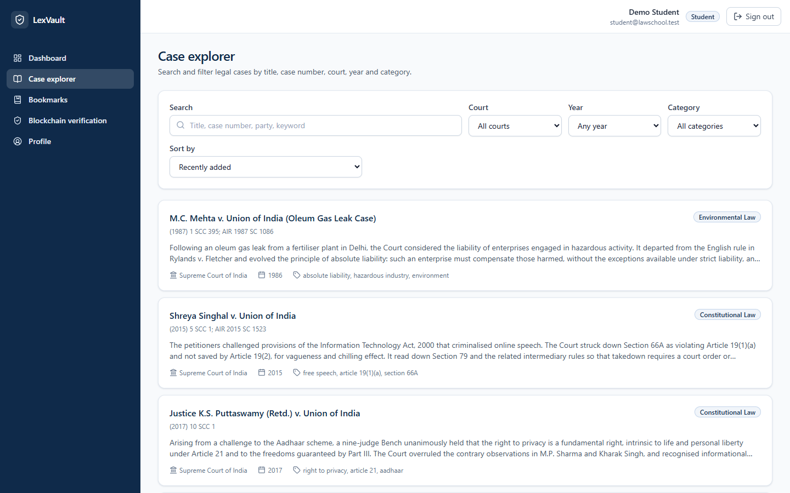

### Case details
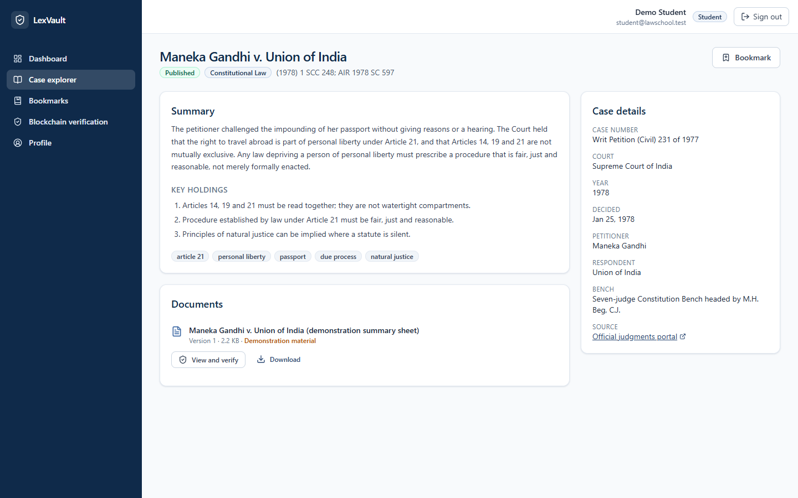

### Blockchain verification: verified


### Blockchain verification: tampering detected


### Document version history
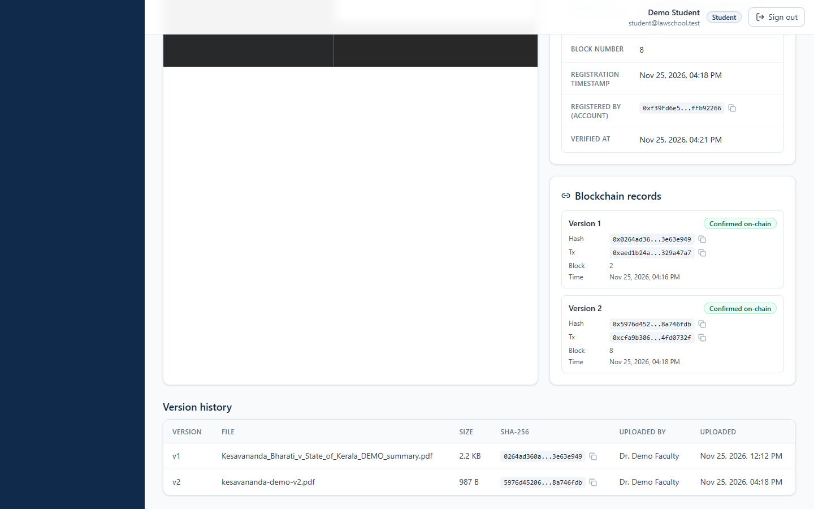

### Faculty dashboard
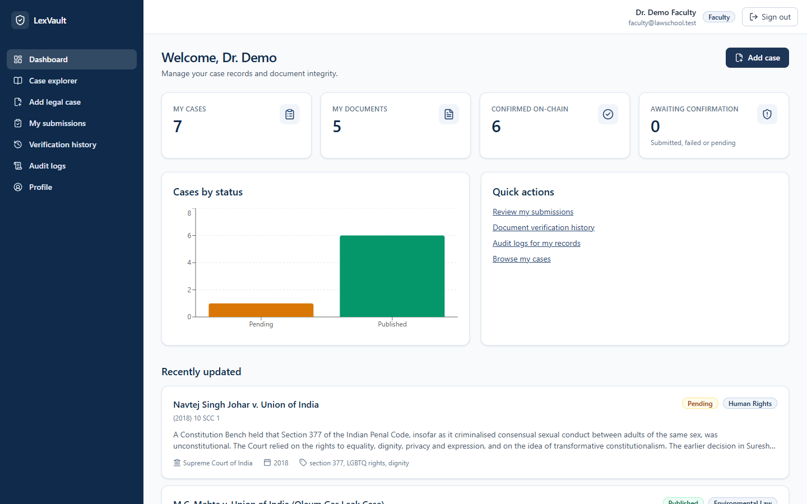

### Case creation
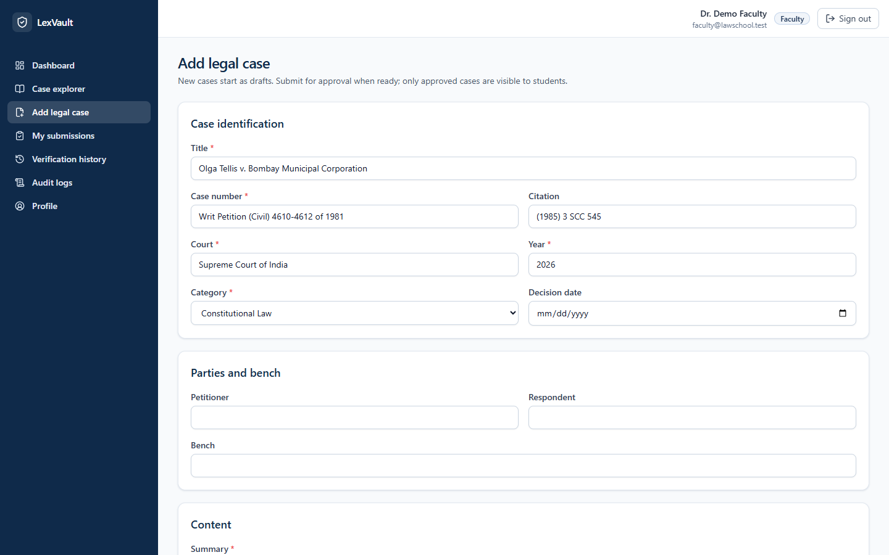

### Document upload
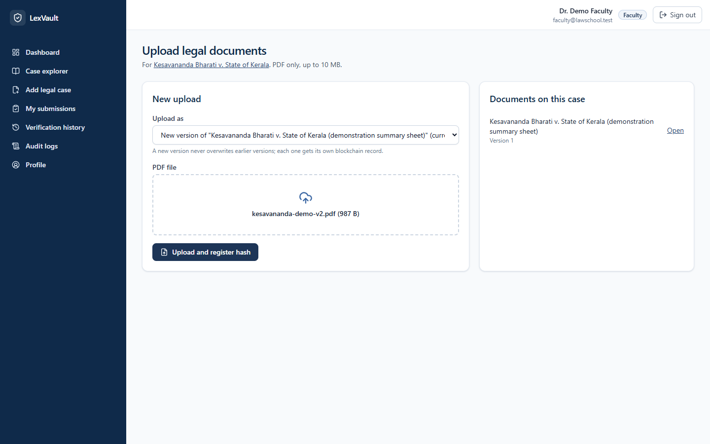

### Administrator dashboard
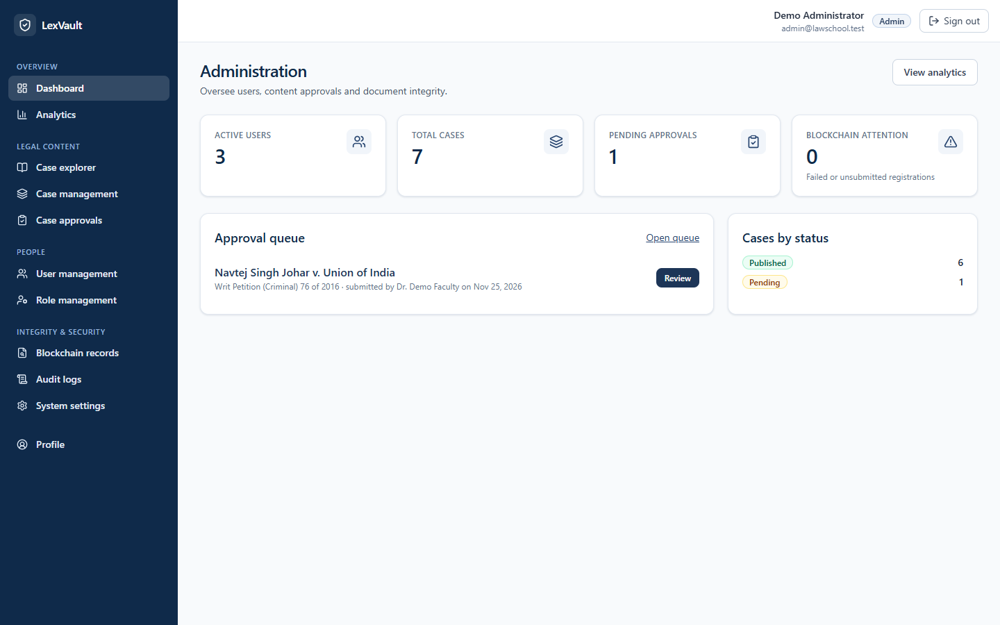

### User management
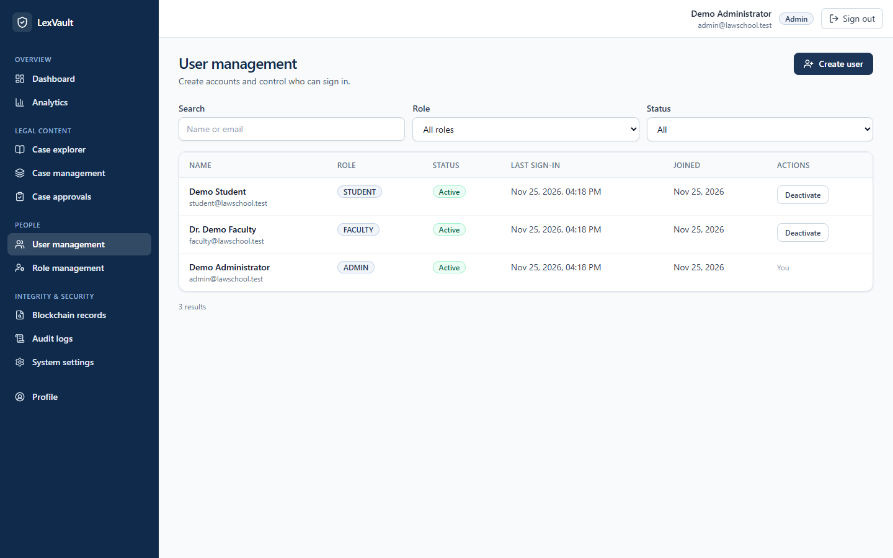

### Case approvals
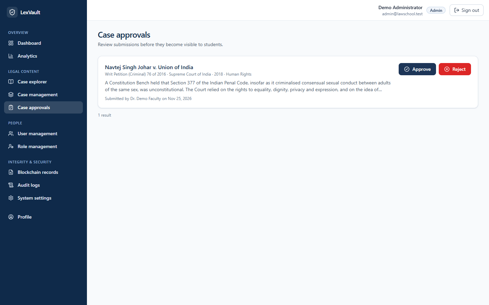

### Blockchain records
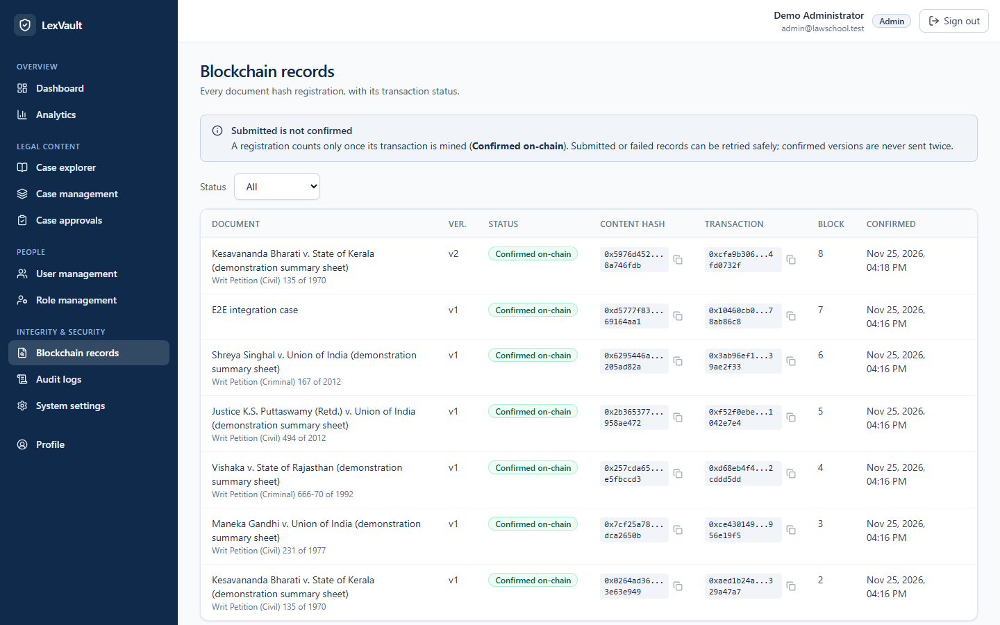

### Audit logs
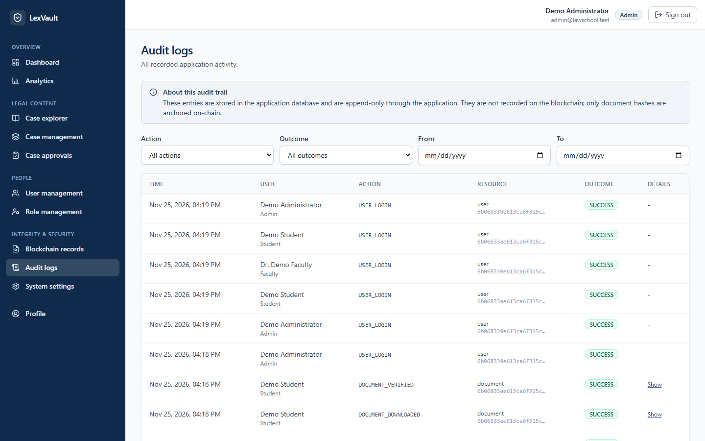

### Analytics
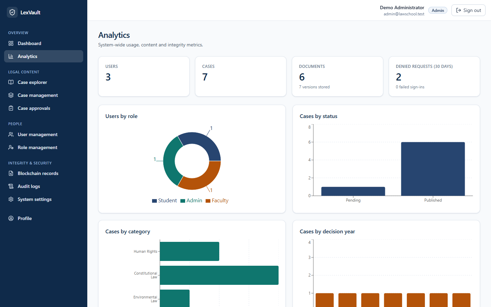

## Security considerations

- Passwords are hashed with bcrypt; sessions use an httpOnly, SameSite=Lax cookie; the role is re-read from the database on every request.
- Every protected route is authorized on the server. Hiding a button in the UI is never relied upon.
- Input is validated with Zod; request keys that could inject NoSQL operators are stripped; search text is escaped.
- Uploads are restricted to PDFs and validated by content; files are stored privately and served only through an authorized endpoint with safe headers.
- Secrets live in git-ignored environment files. The blockchain signing key stays in the backend.
- The audit log is a **database** trail that the application cannot modify. It is not blockchain-immutable; only document hashes are anchored on-chain.

Known limitations (documented in [docs/SECURITY.md](docs/SECURITY.md)): `npm audit` reports advisories in `zod` 3.x, a transitive `lodash` and `react-router-dom` 6, whose fixes need major upgrades; sessions cannot be revoked individually; one operator key signs registrations; storage is local disk only; the Sepolia path is configured but has not been exercised.

## Future enhancements

- Cloud object storage provider and malware scanning of uploads
- Anchoring audit-log digests (for example a Merkle root) on-chain
- Per-user wallets or multi-signer registration
- Password reset, e-mail verification and account lockout
- Zod 4 and React Router 7 upgrades
- Full-text search over PDF content
- Verified Sepolia deployment and a CI pipeline

## Contributors

- **Astik01**, project author and repository owner

### AI assistance disclosure

This project was developed with the assistance of an AI coding tool (Claude Code). Code, tests, screenshots and documentation were produced during development and then run and reviewed. Check your institution's policy on AI-assisted work and extend this statement as it requires.
